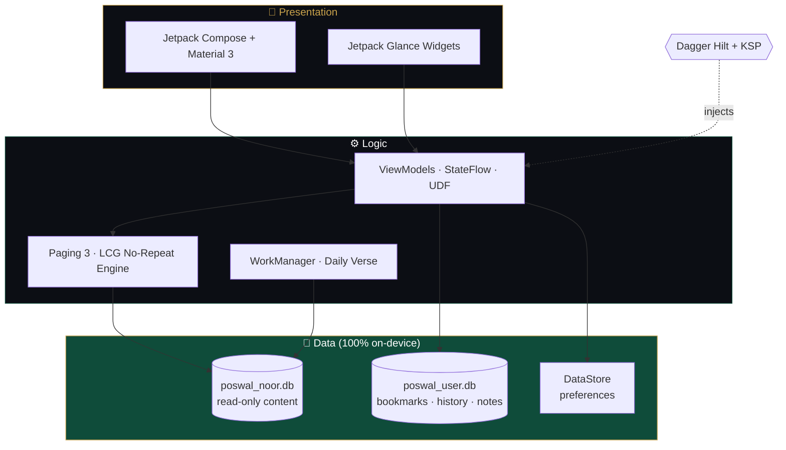

<div align="center">

<br/>

# ﷽

<h1>
  <sub>🌙</sub> Poswal Noor <sub>(نور)</sub>
</h1>

### The complete, 100% offline Islamic companion for Android.
*Quran · Sahih Hadith · Dhikr · Qibla · Prayer Times · Home Screen Widgets — with zero internet permission.*

<br/>

<a href="https://github.com/officialtofeekposwal/PoswalNoor/releases/download/v2.0.0/PoswalNoor-v2.0.0-debug.apk">
  
</a>

<br/><br/>


<br/><br/>

[**Download**](#-download) &nbsp;·&nbsp;
[**Features**](#-features) &nbsp;·&nbsp;
[**Widgets**](#-home-screen-widgets) &nbsp;·&nbsp;
[**Architecture**](#-architecture) &nbsp;·&nbsp;
[**Build**](#-build-from-source) &nbsp;·&nbsp;
[**Credits**](#-content-licensing--attribution)

<br/>

</div>

---

## 🕌 Why Poswal Noor?

Most Islamic apps ask for the internet, location, analytics, and an account — before you can read a single verse.

**Poswal Noor asks for none of it.**

> The app does **not** declare `android.permission.INTERNET` in its `AndroidManifest.xml`.
> It is *physically impossible* for it to send or receive data over a network.

Everything — the Quran, 14,060 Hadiths, prayer times, Qibla — lives on your device and works in airplane mode, in the mosque, in the mountains, anywhere.

<br/>

<div align="center">

| 🔒 **Privacy** | 📖 **Authenticity** | 💎 **Design** |
|:---:|:---:|:---:|
| No internet permission.<br/>No Firebase, analytics, ads or crash beacons. | Zero AI-generated scripture.<br/>Every record is cross-verified and cited. | Apple-inspired *Liquid Glass* UI<br/>in Obsidian, Gold & Emerald. |

</div>

---

## ⬇ Download

<div align="center">

<a href="https://github.com/officialtofeekposwal/PoswalNoor/releases/download/v2.0.0/PoswalNoor-v2.0.0-debug.apk">
  
</a>

| | |
|---|---|
| **Version** | `v2.0.0` — Master Edition |
| **Size** | 27.65 MB |
| **Requires** | Android 8.0 (API 26) or higher |
| **Release notes** | [View on GitHub Releases](https://github.com/officialtofeekposwal/PoswalNoor/releases/tag/v2.0.0) |

</div>

> **How to install:** download the APK → open it → allow *"Install from unknown sources"* for your browser or file manager if prompted → install.

---

## ✨ Features

### 📚 Scripture Reservoir — 20,296 authentic records

<table>
<tr>
<td width="50%" valign="top">

#### 🌙 The Holy Quran
**6,236 Ayahs · 114 Surahs**

- Tanzil Project **Uthmani** Arabic script
- Translations in **English** (Sahih International), **Hindi** (Farooq Khan) and **Urdu** (Jalandhari)
- Surah catalog with **Makki / Madani** badges, English meanings and ayah counts
- Continuous vertical reader with Bismillah headers
- Auto-bookmark with **Continue Reading**

</td>
<td width="50%" valign="top">

#### 📜 Sahih Hadith
**14,060 records**

- **7,050** from *Sahih al-Bukhari* — صحيح البخاري
- **7,010** from *Sahih Muslim* — صحيح مسلم
- Scholar grading, book numbers and narrator chains on every record

</td>
</tr>
</table>

#### 🔎 Instant offline search
Real-time search across all 20,296 records with no latency, no server. It is **diacritic-tolerant** (ignores Tashkeel — Zabar, Zer, etc.) and **Arabic-normalized**, so you find what you mean, not just what you typed.

---

### 🔄 Deterministic No-Repeat Feed Engine

Most feeds loop the same 10–15 cards. Poswal Noor doesn't.

Built on **AndroidX Room + Paging 3** with a Linear Congruential Generator for stable pseudo-random ordering:

```kotlin
Score = ((id * 1103515245 + seed) & 2147483647)
```

- ✅ No repeats while scrolling
- ✅ Scroll position survives device rotation
- ✅ Clean reshuffle on pull-to-refresh
- ✅ Smart **view-dwell tracking** — a card counts as "seen" only after 1 second on screen

---

### 🤲 Daily Spiritual Essentials

| Feature | What it does |
|---|---|
| **Hisnul Muslim & Duas** | Morning/Evening, After Salah, Forgiveness and Hardship supplications with repetition counters (3× / 33× / 100×) and haptic ticks |
| **Digital Tasbih** | Giant 310dp circular dial, animated sweep-gradient progress ring, haptic feedback and lifetime counts |
| **Offline Qibla Compass** | Uses the hardware rotation-vector sensor toward the Kaaba (21.4225° N, 39.8262° E) with a live **±4° alignment lock** |
| **Offline Prayer Times** | Solar-elevation astronomy for Fajr, Sunrise, Dhuhr, Asr (Hanafi / Shafi'i), Maghrib and Isha. **40+ built-in global cities** — no GPS or location permission |
| **Hijri Calendar** | Algorithmic Gregorian → Hijri converter with Islamic holiday highlights |
| **Luxury Image Cards** | Exports **1080×1350** emerald-and-gold quote cards with Amiri calligraphy, shared straight to WhatsApp / Instagram via `FileProvider` |

---

## 📱 Home Screen Widgets

Powered by **Jetpack Glance 1.1.0**. Pin any of them in one tap from the app's top bar (`AppWidgetManager.requestPinAppWidget`).

| Widget | Size | Best for |
|---|:---:|---|
| 🪧 **Banner** | `4×2` | Wide daily reflection card with 1-tap refresh and app deep link |
| 📰 **Magazine** | `4×3` | Rich typography: Arabic calligraphy, translation and topic tags |
| 🌿 **Compact Verse** | `2×2` | A minimalist daily verse for clean home screens |
| 📿 **Launcher Tasbih** | `2×2` | Tap to count dhikr **right from the home screen** — no need to open the app (`ActionCallback`) |

---

## 💎 Liquid Glass Design System

<table>
<tr>
<td width="55%" valign="top">

- **Frosted translucency** — multi-layered background blur, with a graceful solid-surface fallback on older Android versions
- **Inner specular border** — delicate 0.5–1.5dp white highlights that echo Apple's liquid-glass look
- **AGSL lens-refraction shader** on Android 13+ (API 33+)
- **Spring motion** — sliding pill filters with spring physics (`dampingRatio = 0.8f`)

</td>
<td width="45%" valign="top">

**OLED Night Palette**

| | Name | Hex |
|:-:|---|---|
| ⬛ | Deep Obsidian Black | `#0C0E14` |
| 🟨 | Sand Gold | `#C9A24B` |
| 🟩 | Imperial Emerald | `#0F4C3A` |

</td>
</tr>
</table>

### 🔤 Bundled offline typography *(SIL OFL)*

| Script | Typeface | Notes |
|---|---|---|
| **Arabic** | Amiri (Regular & Bold) | Classical Naskh Quranic typeface |
| **Urdu** | Noto Nastaliq Urdu | Authentic Nastaliq with full bi-directional RTL support |
| **Hindi** | Noto Sans Devanagari | Modern, legible Devanagari |
| **English / Hinglish** | Inter / Roboto | Material 3 typography tokens |

---

## 🛡 Privacy & Integrity Guarantees

1. **Zero internet** — no `INTERNET` permission, ever.
2. **Zero telemetry** — no Firebase, analytics, ads, crash beacons or third-party data harvesting.
3. **Dual-database isolation** — your data can never be wiped by an update:

   | Database | Purpose | Access |
   |---|---|---|
   | `poswal_noor.db` | Quran & Hadith content | Pre-packaged, **read-only** |
   | `poswal_user.db` | Bookmarks, reading history, notes | Local Room DB, user-owned |

4. **Authenticity guarantee** — no AI-generated or hallucinated scripture. Quran text comes from the Tanzil Uthmani source; Hadith records come from verified Sahih datasets, with citations.

---

## 🏗 Architecture



### 🧰 Tech Stack

| Layer | Technology |
|---|---|
| **Language** | Kotlin `2.0.21` |
| **UI** | Jetpack Compose + Material 3 |
| **Widgets** | Jetpack Glance `1.1.0` (`glance-appwidget`, `glance-material3`) |
| **Database** | SQLite via AndroidX Room `2.6.1` — dual DB (Asset + User) |
| **Pagination** | Paging 3 (`paging-runtime-ktx`, `paging-compose`, `room-paging`) |
| **DI** | Dagger Hilt `2.51.1` + KSP |
| **Async & state** | Coroutines · StateFlow · Unidirectional Data Flow |
| **Background** | WorkManager `2.9.1` (scheduled daily-verse notifications) |
| **Preferences** | Jetpack DataStore `1.1.1` |
| **Platform** | Min SDK 26 (Android 8.0+) · Target / Compile SDK 34 / 35 |
| **Testing** | JUnit 4 — `ContentDatabaseIntegrityTest`, `NoRepeatEngineTest` (0 failures) |

---

## 🔧 Build from Source

**Prerequisites:** Android Studio (latest stable), JDK 17+ recommended, Android SDK 34/35.

```bash
# 1. Clone
git clone https://github.com/officialtofeekposwal/PoswalNoor.git
cd PoswalNoor

# 2. Build the debug APK
./gradlew assembleDebug

# 3. (Optional) Run the unit tests
./gradlew test
```

Your APK will be at:

```
app/build/outputs/apk/debug/
```

> On Windows, use `gradlew.bat assembleDebug`.

---

## 📋 Content Licensing & Attribution

| Content | Source | License |
|---|---|---|
| Quran — Arabic | Tanzil Project, Uthmani text | Creative Commons Non-Commercial |
| Quran — English | Sahih International | Public / Open Access |
| Quran — Urdu | Fateh Muhammad Jalandhari | Public Domain |
| Hadith | Sahih al-Bukhari & Sahih Muslim, via verified datasets | — |
| Fonts | Amiri, Noto Nastaliq Urdu, Noto Sans Devanagari | SIL Open Font License (OFL) |

The application source code is released under the **MIT License**.

---

## 🤝 Contributing & Feedback

Found a typo in a translation, a rendering bug, or have an idea? Please [open an issue](https://github.com/officialtofeekposwal/PoswalNoor/issues) — corrections to scripture text or grading are especially welcome, with a source cited.

---

## 👤 Author

<div align="center">

**Tofeek Poswal**

[](https://github.com/officialtofeekposwal)
[](mailto:workwithtofeek@gmail.com)

<br/>

*If Poswal Noor benefits you, please ⭐ star the repo and make du'a for everyone who worked on it.*

<br/>

**`0% Online · 100% Offline · 100% Noor`**

<sub>Released under the MIT License · © Tofeek Poswal</sub>

</div>
