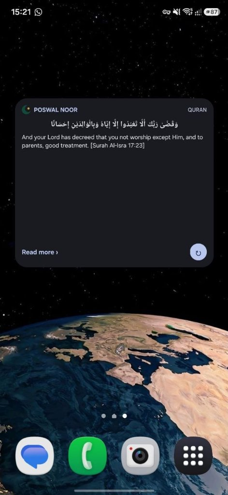

<div align="center">

# 🌙 Poswal Noor (نور)
### The Complete, 100% Offline-First Islamic Companion for Android

<p align="center">
  
</p>

**Authentic Holy Quran • Sahih Hadiths • Glance Home Screen Widgets • Apple-Inspired Liquid Glass UI**  
*Zero Internet • Zero Analytics • Zero Ads • Complete Spiritual Solace*

---

[](https://github.com/officialtofeekposwal/PoswalNoor/releases/tag/v2.0.0)
[](https://github.com/officialtofeekposwal/PoswalNoor/releases/download/v2.0.0/PoswalNoor-v2.0.0-debug.apk)
[](LICENSE)

[](https://kotlinlang.org)
[](https://developer.android.com/jetpack/compose)
[](https://developer.android.com/jetpack/androidx/releases/glance)
[-EA4335.svg?logo=android)](https://developer.android.com)
[](https://github.com/officialtofeekposwal/PoswalNoor)

[📥 Download APK (v2.0.0)](https://github.com/officialtofeekposwal/PoswalNoor/releases/download/v2.0.0/PoswalNoor-v2.0.0-debug.apk) • [✨ Features](#-key-features--capabilities) • [📱 Widgets](#-jetpack-glance-home-screen-widgets) • [💎 Liquid Glass UI](#-apple-inspired-liquid-glass-ui-suite) • [🏛️ Architecture](#-system-architecture) • [📜 Content Sources](#-authentic-scripture-sources)

</div>

---

## 📖 Philosophy & Vision

**Poswal Noor (نور)** is built to restore tranquility in the digital age. Most contemporary Islamic applications are bloated with intrusive banner ads, commercial trackers, pushy subscriptions, and internet-dependent services that sell user attention.

Poswal Noor takes a radically different path:
1. **100% Offline-First**: Contains a pre-packaged 15.55 MB verified SQLite database with **20,296 scripture records**. `android.permission.INTERNET` is not even declared in the `AndroidManifest.xml`.
2. **Zero Distractions**: No ads, no third-party telemetry, no paywalls.
3. **Pure Craftsmanship**: Engineered with **Kotlin 2.0**, **Jetpack Compose**, **Material 3**, and our proprietary **Apple-Inspired Liquid Glass UI Engine**.
4. **Authenticity Without Compromise**: Zero AI-generated or hallucinated scriptures. Every ayah and hadith is cross-referenced from verified open databases (Tanzil & Sahih Hadith collections).

---

## ✨ Key Features & Capabilities

```
┌─────────────────────────────────────────────────────────────────────────────┐
│                       POSWAL NOOR (v2.0.0 MASTER EDITION)                  │
├──────────────────────────┬──────────────────────────┬───────────────────────┤
│ 📚 Scripture Reservoir   │ 💎 Design & Motion       │ 🧭 Offline Utilities  │
│ • 6,236 Quran Ayahs      │ • Liquid Glass Engine    │ • 3D Qibla Compass    │
│ • 14,060 Sahih Hadiths   │ • Frosted Blurs & AGSL   │ • Solar Prayer Times  │
│ • 114 Surahs Full Reader │ • Spring Physics Pills   │ • Digital Dhikr Dial  │
│ • Diacritic Search       │ • OLED Deep Black Theme  │ • Hijri Calendar      │
│ • No-Repeat Feed Engine  │ • Amiri & Nastaliq Fonts │ • 1080p Card Exporter │
└──────────────────────────┴──────────────────────────┴───────────────────────┘
```

### 1. 📚 Complete Holy Quran Reader & Surah Catalog
- **All 114 Surahs**: Complete Quranic catalog featuring ornate Makki/Madani badges, Arabic calligraphy titles, English meanings, and ayah totals.
- **Continuous Reading Experience**: Fluid vertical scroll with Bismillah calligraphy headers, numbered ayah medallions, and customizable typography.
- **Auto-Persistence**: Remembers your exact reading spot across sessions with a 1-tap "Continue Reading" banner.

### 2. 📜 Complete Sahih Hadith Browser
- **14,060 Authentic Narrations**:
  - **7,050** Hadiths from **Sahih al-Bukhari** (صحيح البخاري)
  - **7,010** Hadiths from **Sahih Muslim** (صحيح مسلم)
- **Scholarly Verification**: Every record includes chapter titles, book indices, hadith reference numbers, primary narrators, and authenticity gradings.

### 3. 🔄 Mathematical Deterministic No-Repeat Feed Engine
- Solves the repetition bug found in standard apps. An intelligent **Room Paging 3** engine powered by Linear Congruential pseudo-random scoring:
  $$\text{Score} = ((\text{id} \times 1103515245 + \text{seed}) \ \& \ 2147483647)$$
- Items maintain deterministic positions across screen rotations, while pulling-to-refresh seeds a fresh journey.
- **Seen History Tracker**: Automatically tracks viewed cards after 1 second of dwell time and prevents repeats across hundreds of swipes.

### 4. 🔍 100% Offline Scripture Search
- Real-time search engine scanning all 20,296 records with zero latency.
- **Diacritic-Tolerant & Arabic Normalized**: Search seamlessly in Arabic (Uthmani or simplified), English, Hindi, or Urdu without getting blocked by diacritics (Tashkeel).

### 5. 🤲 Hisnul Muslim (Fortress of the Muslim) & Daily Duas
- Handpicked authentic supplications organized by time and situation: Morning & Evening, After Prayer, Forgiveness, and Times of Distress.
- **Interactive Repetition Counters**: Built-in 3x, 33x, and 100x target circles with gentle haptic pulse feedback on each tap.

### 6. 📿 Digital Tasbih / Dhikr Counter
- **310dp Immersive Dial**: Tactile counter with animated circular sweep gradients and smooth spring recovery.
- **Tactile Haptic Feedback**: Distinct vibration bursts for single clicks and lap milestones.
- **Built-in Presets**: SubhanAllah, Alhamdulillah, Allahu Akbar, Astaghfirullah, and custom targets with lifetime stats.

### 7. 🧭 Offline Sensor Qibla Compass & Astronomical Prayer Times
- **3D Sensor Compass**: Employs the device's hardware rotation vector sensor to point towards the Kaaba ($21.4225^\circ\text{ N}, 39.8262^\circ\text{ E}$) with live visual alignment lock ($\pm 4^\circ$).
- **Solar Astronomical Prayer Calculation**: Calculates Fajr, Sunrise, Dhuhr, Asr (Standard / Hanafi), Maghrib, and Isha using solar elevation formulas on-device.
- **Zero Location Permissions Required**: Includes a built-in offline database of 40+ major global cities, allowing complete operation without location access.

### 8. 📅 Algorithmic Hijri Calendar
- On-device astronomical conversion from Gregorian to Islamic Hijri dates.
- Highlights prominent Islamic dates including Ramadan, Eid al-Fitr, Eid al-Adha, Day of Arafah, and Ashura.

### 9. 🖼️ Social Share as Styled Luxury Image Card
- Generates high-resolution **1080 × 1350 Instagram / WhatsApp-ready image cards**.
- Rendered offscreen with deep emerald gradients, geometric gold Islamic borders, and bundled Amiri calligraphy—shared instantly via secure `FileProvider`.

---

## 📱 Jetpack Glance Home Screen Widgets

Transform your phone's home screen into an uplifting spiritual sanctuary with 4 specialized Glance widgets:

| Widget Layout | Description | Interactive Controls |
| :--- | :--- | :--- |
| **4x2 Banner** | Wide reflection card displaying daily ayah/hadith with full translation and citation | 1-tap refresh button & deep link to reflection reader |
| **4x3 Magazine** | Expanded layout with Arabic calligraphy, localized translation, and theme chip | 1-tap refresh, bookmark shortcut & deep link |
| **2x2 Compact Verse** | Minimalist daily verse card designed for clean home screen setups | Deep link to reflection detail |
| **2x2 Launcher Tasbih** | Interactive launcher widget to perform dhikr directly from your home screen | Tap `+` counter without launching the app (`ActionCallback`) |

> **1-Tap Pinning**: Add any widget directly from inside the app's top bar or settings using Android's native `AppWidgetManager.requestPinAppWidget`.

---

## 💎 Apple-Inspired Liquid Glass UI Suite

Poswal Noor features a bespoke design system created exclusively for modern Android:

* **Frosted Translucency**: High-performance multi-layered background blur with graceful solid-surface fallback on older Android devices.
* **Liquid Borders**: Subtle white inner highlights ($0.5\text{dp} - 1.5\text{dp}$) replicating premium Apple frosted-glass edges.
* **AGSL Lens Refraction Shader**: Custom Android Graphics Shading Language shader on Android 13+ (API 33+) simulating real light refraction.
* **OLED Deep Night Palette**: Deep Obsidian Black (`#0C0E14`) paired with Imperial Emerald (`#0F4C3A`) and Sand Gold (`#C9A24B`).
* **Haptic & Spring Motion**: Segmented sliding pill filters with spring physics (`dampingRatio = 0.8f`, `stiffness = 380f`).

---

## 🔤 Bundled Offline Typography

No network downloads needed. All fonts are bundled directly in the APK under the SIL Open Font License (OFL):

* 🇸🇦 **Arabic:** [Amiri (Regular & Bold)](https://fonts.google.com/specimen/Amiri) — Renowned classical Naskh typeface designed for exquisite Quranic reading.
* 🇵🇰 **Urdu:** [Noto Nastaliq Urdu](https://fonts.google.com/noto/specimen/Noto+Nastaliq+Urdu) — Authentic Nastaliq script with full bi-directional RTL support.
* 🇮🇳 **Hindi:** [Noto Sans Devanagari](https://fonts.google.com/noto/specimen/Noto+Sans+Devanagari) — Clean, legible modern Devanagari typography.
* 🇬🇧 **English & Hinglish:** Inter / Roboto with Material 3 typography tokens.

---

## 🏛️ System Architecture

Poswal Noor follows modern Android architectural guidelines (**Clean Architecture + MVVM + UDF + Hilt + Room**):

```
┌────────────────────────────────────────────────────────────────────────┐
│                        UI LAYER (Jetpack Compose)                      │
│   HomeScreen  •  QuranReader  •  HadithBrowser  •  Tasbih  •  Qibla    │
└───────────────────────────────────┬────────────────────────────────────┘
                                    │ StateFlow / UI Events
┌───────────────────────────────────▼────────────────────────────────────┐
│                    VIEWMODEL LAYER (AAC ViewModels)                    │
│   HomeViewModel  •  QuranViewModel  •  TasbihViewModel  •  DuaVM       │
└───────────────────────────────────┬────────────────────────────────────┘
                                    │ Coroutines / Kotlin Flow
┌───────────────────────────────────▼────────────────────────────────────┐
│                       DOMAIN LAYER (Use Cases)                         │
│   GetNoRepeatFeedUseCase  •  SearchScripture  •  CalculatePrayerTimes  │
└───────────────────────────────────┬────────────────────────────────────┘
                                    │ Repositories
┌───────────────────────────────────▼────────────────────────────────────┐
│                   DATA LAYER (Dual-Database Isolation)                 │
│  ┌───────────────────────────────┐   ┌──────────────────────────────┐  │
│  │     poswal_noor.db (Asset)    │   │      poswal_user.db (User)   │  │
│  │ • 6,236 Ayahs                 │   │ • Saved Bookmarks & Folders  │  │
│  │ • 14,060 Sahih Hadiths        │   │ • Seen Items History (Feed)  │  │
│  │ • 114 Surahs Metadata         │   │ • Personal Reflection Notes  │  │
│  │ • Read-Only Pre-Packaged      │   │ • Offline JSON Export/Import │  │
│  └───────────────────────────────┘   └──────────────────────────────┘  │
└────────────────────────────────────────────────────────────────────────┘
```

---

## 📦 Download & Installation

### Option 1: Direct APK Download (Recommended)
1. Download the latest release: **[PoswalNoor-v2.0.0-debug.apk](https://github.com/officialtofeekposwal/PoswalNoor/releases/download/v2.0.0/PoswalNoor-v2.0.0-debug.apk)** *(27.65 MB)*.
2. Open the downloaded file on your Android device (Android 8.0+ / API 26+).
3. If prompted, enable *"Install from unknown sources"*.

### Option 2: Build from Source
```bash
# 1. Clone the repository
git clone https://github.com/officialtofeekposwal/PoswalNoor.git
cd PoswalNoor

# 2. Run unit & integrity tests
./gradlew testDebugUnitTest

# 3. Compile debug APK
./gradlew assembleDebug

# Output APK path:
# app/build/outputs/apk/debug/app-debug.apk
```

---

## 📜 Authentic Scripture Sources

To safeguard religious sanctity, **no scripture text is generated, altered, or hallucinated by AI**. All data is imported via reproducible scripts (`tools/build_content_db.py`) from accredited open-source repositories:

| Scripture Domain | Source / Authority | License | Records |
| :--- | :--- | :--- | :--- |
| **Holy Quran (Arabic)** | [Tanzil Project](https://tanzil.net) (Uthmani Text) | Creative Commons / Tanzil License | 6,236 Ayahs |
| **Quran English Translation** | Sahih International | Open Access / Public | 6,236 Ayahs |
| **Quran Hindi Translation** | Muhammad Farooq Khan & Ahmad | Open Access | 6,236 Ayahs |
| **Quran Urdu Translation** | Maulana Fateh Muhammad Jalandhari | Public Domain | 6,236 Ayahs |
| **Sahih al-Bukhari** | Sahih al-Bukhari verified dataset | Open Database / Educational | 7,050 Hadiths |
| **Sahih Muslim** | Sahih Muslim verified dataset | Open Database / Educational | 7,010 Hadiths |

*Full details and licenses are documented in [DATA_SOURCES.md](DATA_SOURCES.md).*

---

## 🔒 Absolute Privacy Guarantee

- 🚫 **No `android.permission.INTERNET`**: The app cannot make network calls even if it wanted to.
- 🚫 **Zero Third-Party SDKs**: No Google Firebase, Facebook SDK, Adjust, Flurry, or ad frameworks.
- 🚫 **No Analytics**: Zero event tracking, crash beacons, or screen recording.
- 🚫 **No Account Required**: No logins, email registrations, or phone numbers.
- 💾 **Local Data Portability**: Export your bookmarks and reflections anytime via standard JSON files using Android's native Storage Access Framework (SAF).

---

## 👨‍💻 Author & Maintainer

<div align="center">

Crafted with dedication by **[Tofeek Poswal](https://github.com/officialtofeekposwal)**  
📧 Contact: `workwithtofeek@gmail.com`  
🐙 GitHub: [@officialtofeekposwal](https://github.com/officialtofeekposwal)

---

### 📄 License
This project is open-source under the terms of the [MIT License](LICENSE).  
*May this work serve as a continuous benefit (Sadaqah Jariyah) for everyone seeking spiritual remembrance.*

</div>
