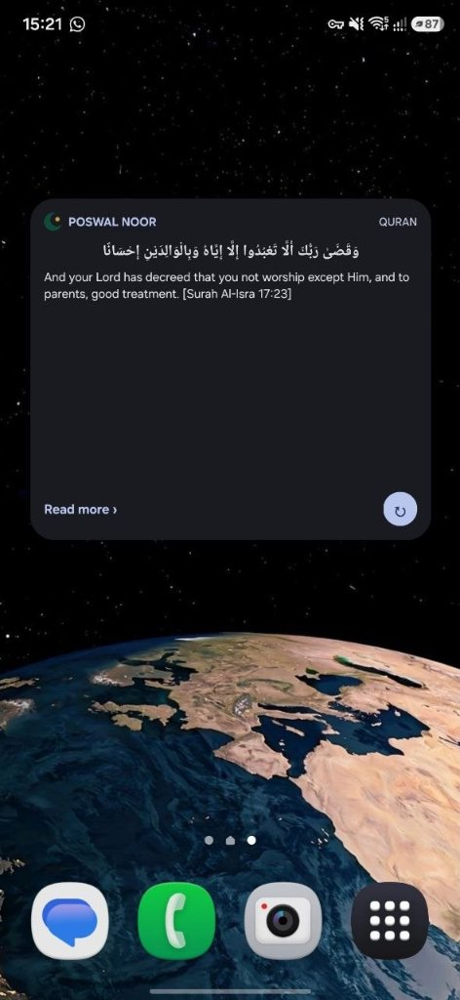

# Poswal Noor (نور)

<div align="center">


**An all-in-one, privacy-first Islamic companion with a signature Glance Home Screen Widget, authentic Quran & Hadith reflections, and 5-language support.**

[](LICENSE)
[](https://kotlinlang.org)
[-C9A24B.svg?logo=android)](https://developer.android.com)
[](https://developer.android.com/jetpack/compose)
[](https://developer.android.com/jetpack/androidx/releases/glance)
[](#)

[Download Latest APK (v1.0.0)](https://github.com/officialtofeekposwal/PoswalNoor/releases/download/v1.0.0/PoswalNoor-v1.0.0-debug.apk) • [Releases](https://github.com/officialtofeekposwal/PoswalNoor/releases) • [Architecture](#architecture--project-structure) • [Getting Started](#getting-started)

</div>

---

## 📱 Live Home Screen Widget Preview

<div align="center">
  
  <p><i>Poswal Noor Glance Widget running natively on Android with custom dark/light theme, instant refresh, and deep link navigation.</i></p>
</div>

---

## 📖 About The Project

**Poswal Noor** is a modern, native Android Islamic companion designed around a simple yet powerful habit: delivering authentic, beautiful, and distraction-free daily reflections directly to your phone's home screen.

Most contemporary apps are cluttered with intrusive ads, background trackers, and subscription paywalls. Poswal Noor is built strictly **offline-first**, completely free of telemetry, and engineered with clean architecture using modern Android standards (Kotlin 2.0, Jetpack Compose, Jetpack Glance, and Room).

---

## ✨ Key Features

- **⚡ Signature Glance Home Screen Widget (4x2 & 4x3)**:
  - Displays authentic Quran ayat and Sahih hadiths filtered to concise lengths (`word_count <= 40`) optimal for home screens.
  - Interactive **Refresh** button for instant random rotation right from the launcher.
  - **Read more ›** action deep-linking straight into the full scripture detail view.
  - 1-Tap **"Add Widget to Home Screen"** (`AppWidgetManager.requestPinAppWidget`) built directly into the app.
- **🌍 5-Language System with Fallback**:
  - **English (`en`)**
  - **Hinglish / Roman Urdu & Hindi (`en-IN`)**: Everyday conversational Roman script for South Asian multilingual readers.
  - **हिन्दी (`hi`)**: Devanagari script.
  - **اردو (`ur`)**: Nastaliq-tuned RTL layout with relaxed line-height.
  - **العربية (`ar`)**: Pure pristine Arabic text (automatically omits translation redundancy).
  - Graceful fallback: when regional translations are unavailable under open licenses, defaults to verified English with a clear indicator tag.
- **📚 100% Offline-First Database**:
  - Pre-packaged SQLite database in Room (`poswal_noor.db`) providing zero-latency startup and zero network reliance.
  - Authentic Uthmani Quranic text from the **Tanzil Project** and Sahih English from **Sahih International**.
  - **Sahih al-Bukhari** and **Sahih Muslim** hadiths with verified book numbers, hadith indices, and authenticity gradings.
- **🏷️ Topic-Based Categorization**:
  - Filter content across 9 essential life themes: `Namaz`, `Sabr`, `Akhlaq`, `Parents`, `Dua`, `Akhirah`, `Ilm`, `Charity`, `Family`.
- **🎨 Brand Kit & Accessibility-Compliant Theme**:
  - Handcrafted luxury palette: Emerald (`#0F4C3A`), Deep Emerald (`#0A3427`), Gold (`#C9A24B`), and Ivory (`#F6F1E4`).
  - Strict WCAG contrast compliance: Gold is never placed as text over Ivory (maintaining >9:1 readable contrast).
  - Font pairings: **Amiri** for Quranic Arabic, **Fraunces** for headings, and **Inter** for UI body.
- **⏰ Scheduled Widget Updates**:
  - Configurable background auto-change interval (1h, 3h, 6h, 12h, 24h) powered by Android Jetpack **WorkManager**.
- **📋 Native Sharing & Favorites**:
  - One-tap clipboard copy and Android system Share intents.
  - Persistent favorite bookmarking stored locally in Room.

---

## 🛠️ Tech Stack & Architecture

| Layer | Technologies |
|---|---|
| **Language** | [Kotlin 2.0.21](https://kotlinlang.org/) |
| **UI Framework** | [Jetpack Compose](https://developer.android.com/jetpack/compose) + [Material 3](https://m3.material.io/) |
| **Widgets** | [Jetpack Glance 1.1.0](https://developer.android.com/jetpack/androidx/releases/glance) (`glance-appwidget`, `glance-material3`) |
| **Architecture** | Clean Architecture (MVVM + Repository Pattern) |
| **Dependency Injection** | [Dagger Hilt 2.51.1](https://dagger.dev/hilt/) + KSP |
| **Local Persistence** | [AndroidX Room 2.6.1](https://developer.android.com/training/data-storage/room) (SQLite) |
| **Preferences** | [Jetpack DataStore 1.1.1](https://developer.android.com/topic/libraries/architecture/datastore) |
| **Background Work** | [AndroidX WorkManager 2.9.1](https://developer.android.com/topic/libraries/architecture/workmanager) |
| **Min / Target SDK** | Min SDK 26 (Android 8.0) • Compile / Target SDK 34 (Android 14) |

---

## 📂 Architecture & Project Structure

```
PoswalNoor/
├── app/
│   ├── build.gradle.kts                   # Module build config & dependencies
│   ├── src/
│   │   ├── main/
│   │   │   ├── AndroidManifest.xml        # Declarations, deep links & widget receivers
│   │   │   ├── assets/database/
│   │   │   │   └── poswal_noor.db         # Pre-packaged verified Room SQLite DB
│   │   │   ├── java/com/poswal/noor/
│   │   │   │   ├── NoorApp.kt             # Application class (@HiltAndroidApp)
│   │   │   │   ├── data/
│   │   │   │   │   ├── local/             # Room Database, DAO, and Entities
│   │   │   │   │   ├── preferences/       # DataStore UserPreferencesRepository
│   │   │   │   │   └── repository/        # ContentRepository implementation
│   │   │   │   ├── di/                    # Hilt modules (DatabaseModule, RepositoryModule)
│   │   │   │   ├── domain/
│   │   │   │   │   ├── model/             # AppLanguage, ContentType, Topic, ContentItem
│   │   │   │   │   └── repository/        # Domain repository interfaces
│   │   │   │   ├── ui/
│   │   │   │   │   ├── MainActivity.kt    # Single activity with NavHost & deep link handler
│   │   │   │   │   ├── home/              # HomeScreen with segmented filters & reflection card
│   │   │   │   │   ├── detail/            # DetailScreen with full Arabic, translations, copy & share
│   │   │   │   │   ├── settings/          # SettingsScreen (language, topics, auto-refresh)
│   │   │   │   │   ├── onboarding/        # First-launch language onboarding screen
│   │   │   │   │   └── theme/             # Brand Kit Color, Typography & NoorTheme (Light/Dark)
│   │   │   │   ├── util/
│   │   │   │   │   └── WidgetPinHelper.kt # 1-tap requestPinAppWidget helper
│   │   │   │   ├── widget/
│   │   │   │   │   ├── NoorGlanceWidget.kt# GlanceAppWidget implementation (4x2 and 4x3)
│   │   │   │   │   ├── NoorWidgetReceiver.kt
│   │   │   │   │   └── RefreshWidgetCallback.kt
│   │   │   │   └── worker/
│   │   │   │       └── WidgetUpdateWorker.kt # Periodic WorkManager refresh job
│   │   │   └── res/
│   │   │       ├── drawable/              # Brand vectors (ic_noor_mark, etc.)
│   │   │       ├── layout/                # Widget loading and placeholder layouts
│   │   │       ├── values/                # Strings (English), Brand Colors, Themes
│   │   │       ├── values-hi/             # Hindi strings
│   │   │       ├── values-ur/             # Urdu strings
│   │   │       ├── values-ar/             # Arabic strings
│   │   │       └── xml/                   # AppWidgetProviderInfo (4x2, 4x3) & locales_config.xml
│   │   └── test/                          # Unit tests (AppLanguageTest, RandomPickerLogicTest)
├── docs/
│   ├── PROGRESS.md                        # Phase milestone tracking & verification logs
│   └── screenshots/                       # Widget & App UI visual captures
├── gradle/
│   └── libs.versions.toml                 # Centralized Gradle Version Catalog
└── scripts/
    └── import_content.py                  # Content validation & Room DB compilation script
```

---

## 🚀 Getting Started

### Prerequisites
- **JDK**: Java Development Kit 21+ (`JAVA_HOME` pointing to JDK 21).
- **Android SDK**: Compile SDK 34, Min SDK 26.
- **Git**

### Clone & Build
```bash
# 1. Clone repository
git clone https://github.com/officialtofeekposwal/PoswalNoor.git
cd PoswalNoor

# 2. Run unit tests
./gradlew test

# 3. Assemble debug APK
./gradlew assembleDebug
```
The compiled APK will be generated at:
```
app/build/outputs/apk/debug/app-debug.apk
```

---

## 🧪 Testing & Verification

Unit tests are included to verify data integrity, language fallbacks, and widget filters:
```bash
./gradlew testDebugUnitTest
```
- **`AppLanguageTest`**: Verifies translation mapping across all 5 languages, Arabic translation suppression, and Hindi/Urdu/Hinglish fallback to English.
- **`RandomPickerLogicTest`**: Enforces strict `word_count <= 40` constraint for widget items and verifies topic/content-type filtering logic.

---

## 📜 Content Sources & Licensing

To preserve religious and scholarly integrity, **no text is machine-translated or paraphrased**:
1. **Quran Arabic**: Tanzil Project Uthmani script (Open Non-Commercial Attribution).
2. **Quran English**: Sahih International (Public / Open License).
3. **Quran Urdu**: Fateh Muhammad Jalandhry (Public Domain).
4. **Hadith Collections**: Sahih al-Bukhari & Sahih Muslim via `fawazahmed0/hadith-api` (MIT License). Every hadith includes book numbers, hadith reference numbers, and authenticity gradings.

---

## 🔒 Privacy & Safety Guarantee

- **No Ads & No Analytics**: Zero third-party ad networks, tracking SDKs, or data harvesting libraries.
- **100% Offline**: Content lives in local storage; the app operates with zero network connectivity.
- **No Unnecessary Permissions**: Requires no sensitive runtime permissions (no location, microphone, or contacts required for Phase 1).

---

## 📄 License

This project is licensed under the [MIT License](LICENSE) © 2026 **Tofeek Poswal**.

---

<div align="center">
  <sub>Developed with care by <a href="https://github.com/officialtofeekposwal">Tofeek Poswal</a>.</sub>
</div>
